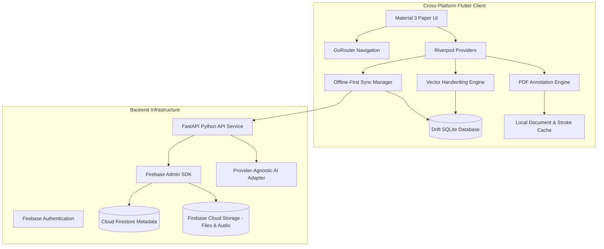

# Naik Notes — Architectural Specification

## 1. System Overview

**Naik Notes** is an offline-first, cross-platform digital handwritten notebook and PDF annotation suite targeting iPadOS, Android, and Windows 10/11. The core philosophy blends realistic stationery tactile feel with vector editing and synchronization.

---

## 2. Layered Architecture (Feature-First)

The codebase strictly adheres to feature-driven domain segregation:

1. **`core/`**: Cross-cutting foundation.
   - `config/`: Environment profiles, build configurations, and runtime flags.
   - `constants/`: Global dimensions, pen types, stroke defaults, time formats.
   - `errors/`: Typed failure models, exception handlers, recovery fallback paths.
   - `theme/`: M3 paper-inspired palette (Ivory, Charcoal, Terracotta, Sage, Slate), typography, and component decorations.
   - `routing/`: Declarative GoRouter routing definitions and transition builders.
   - `utilities/`: Mathematical helpers for Bezier curve smoothing, Douglas-Peucker point decimation, and coordinate normalization.

2. **`features/`**: Independent, decoupled functional verticals:
   - `authentication/`: Sign in, sign up, session management, token refresh.
   - `dashboard/`: Notebook grid/list views, search bar, recent activity, folders.
   - `notebooks/`: Notebook lifecycle, page navigation, section organization.
   - `handwriting/`: Vector stroke capture, pressure smoothing, undo/redo, lasso transform.
   - `pdf_editor/`: PDF rendering, multi-type annotation layers, vector overlay, export.
   - `templates/`: Paper background generator (grids, ruled, dotted, planners, custom).
   - `audio_notes/`: Audio capture, synchronized timestamps, playback scrubber.
   - `ai_assistant/`: Document summaries, flashcard generation, study Q&A.
   - `version_history/`: Page snapshots, diffing, rollback.
   - `settings/`: Sync controls, device registration, theme preferences.

3. **`data/`**: Data persistence and networking:
   - `local/`: Drift ORM database definitions, migrations, SQLite schema.
   - `remote/`: HTTP API client, REST endpoints, backend serialization.
   - `repositories/`: Repository implementations uniting local and remote sources.
   - `models/`: Immutable domain models with copyWith, toJson, and fromJson.

4. **`services/`**: Infrastructure and hardware bridges:
   - `sync/`: Background sync queue, retry with exponential backoff, conflict resolver.
   - `storage/`: Local file system persistence, cache management.
   - `audio/`: Cross-platform microphone access and file writing.
   - `export/`: PDF flattening, image export, zip archive backup.

5. **`platform/`**: Native integration adapters:
   - `ios/`: Apple Pencil double-tap, hover, low-latency drawing channel.
   - `android/`: S-Pen / stylus pressure and palm rejection tuning.
   - `windows/`: Mouse scroll, digitizer pen, touch gestures, keyboard shortcuts.

---

## 3. Data Integrity & Sync Principles

- **Offline-First**: All writes (strokes, notebooks, annotations) are committed immediately to the local Drift database with a dirty sync flag before any network request.
- **Normalized Vector Representation**: Strokes are recorded in resolution-independent document space (0.0 to page width/height) rather than viewport pixels, ensuring parity across screen sizes.
- **Conflict Resolution**: Multi-device conflicts are resolved using vector revision counters and deterministic operation IDs. Conflicting pages spawn non-destructive alternate versions rather than overwriting.
- **Secure Backend Bridge**: The client interacts with Firebase through official plugins and a secure FastAPI proxy with Firebase Admin SDK, ensuring full cross-platform compatibility across Windows, Android, and iPadOS.

