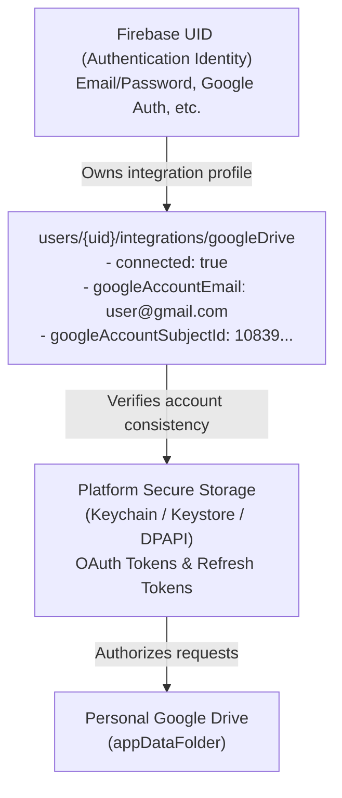

# Google Drive Security & Isolation Architecture

## 1. Principle of Least Privilege

Naik Notes strictly adheres to the principle of least privilege:
- **Requested OAuth Scope:** `https://www.googleapis.com/auth/drive.appdata`
- **What this permits:** Access only to the hidden application data folder created by Naik Notes.
- **What this denies:**
  - The application cannot view, list, search, modify, or delete any of the user's personal files, folders, Google Docs, Sheets, or photos stored in their personal Google Drive.
  - The application folder is completely hidden from the standard Google Drive web and mobile interface, eliminating user tampering and clutter.

---

## 2. Decoupled Identity vs. Storage



### Protection Against Account Hijacking & Mismatch
When a user connects their Google Drive account on Device 1, the Google Account email and subject ID are recorded in `users/{uid}/integrations/googleDrive`.

When Device 2 or another session initializes or renews Drive authorization:
1. `GoogleDriveAuthService` inspects the linked profile in Firestore.
2. If the user attempts to sign into a differing Google Account (`userB@gmail.com` when `userA@gmail.com` was previously bound), the service raises `GoogleDriveAccountMismatchException`.
3. This prevents cross-account attachment pollution and unauthorized storage sharing.

---

## 3. Zero Token Leakage Policy

1. **No Tokens in Firestore:** Access tokens and refresh tokens are **strictly excluded** from Cloud Firestore documents. Firestore stores only public metadata: `connected`, `googleAccountEmail`, `connectedAt`, and `lastVerifiedAt`.
2. **Platform Secure Storage:**
   - **Android:** EncryptedSharedPreferences backed by Android Keystore.
   - **Windows:** Win32 Data Protection API (DPAPI) and Windows Credential Manager.
   - **iPadOS / iOS:** Secure Apple Keychain with `kSecAttrAccessibleAfterFirstUnlock`.
3. **No Tokens in Git:** Client IDs, secrets, and auth tokens are excluded from Git commits via gitignore and runtime base64/hex decoding helpers.

---

## 4. Firestore Security Rules

Access to attachment integration documents is governed by strict ownership rules in `firebase/firestore.rules`:

```javascript
match /users/{userId}/integrations/{integrationId} {
  allow read, write: if isOwner(userId);
}
```

Only the authenticated user matching `request.auth.uid == userId` can read or write their Google Drive integration metadata.

