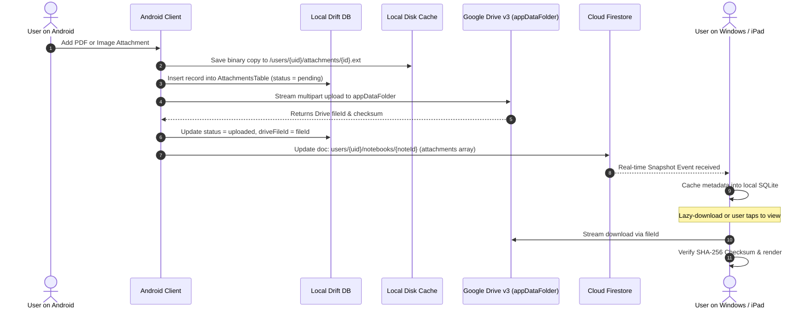

# Google Drive Multi-Device Synchronization Architecture

## 1. Overview & Flow

Naik Notes implements a hybrid synchronization pipeline where lightweight note documents, notebook hierarchies, and stroke data synchronize through **Cloud Firestore**, while large binary attachments (PDFs, images, diagrams) are stored in each user's private Google Drive application folder (`appDataFolder`).

---

## 2. Multi-Device Synchronization Matrix

| Scenario | Android | Windows Desktop | iPadOS / iOS |
| :--- | :--- | :--- | :--- |
| **Authentication Source** | `GoogleSignIn` native SDK | Ephemeral Loopback Server (RFC 8252 + PKCE) | `GoogleSignIn` native SDK |
| **Token Storage** | Android Keystore (`flutter_secure_storage`) | Windows DPAPI / Credential Vault | Apple Keychain (`flutter_secure_storage`) |
| **Local Cache Directory** | `getApplicationDocumentsDirectory()/users/{uid}/attachments/` | `getApplicationDocumentsDirectory()/users/{uid}/attachments/` | `getApplicationDocumentsDirectory()/users/{uid}/attachments/` |
| **Offline Attachment Queue** | Drift SQLite `AttachmentsTable` | Drift SQLite `AttachmentsTable` | Drift SQLite `AttachmentsTable` |
| **File Picker** | Native Android document picker | Win32 native file dialog (`file_picker`) | iOS Document Picker / Photos |

---

## 3. Offline Queueing and Resilience

1. **Disconnected / Offline Mode:**
   - If the user takes notes while disconnected from Google Drive or offline, the attachment binary is saved directly into the local user partition.
   - The attachment is inserted into SQLite with status `AttachmentUploadStatus.availableOffline` or `driveDisconnected`.
   - The note remains completely editable, viewable, and responsive without blocking UI threads.
2. **Reconnection & Automatic Catch-Up:**
   - When Google Drive connects in Settings or connectivity resumes, `AttachmentSyncCoordinator.syncPendingUploads(uid)` scans SQLite for all un-synced attachments.
   - Each item is processed sequentially with exponential backoff on 429/5xx errors.
   - Upon upload completion, metadata is synced into Cloud Firestore.

---

## 4. Chunked Streaming & Integrity Validation

- **SHA-256 Checksumming:** All files have their SHA-256 hash computed before upload and stored in SQLite/Firestore.
- **Download Integrity Verification:** Upon downloading from Google Drive, `GoogleDriveStorageService` computes the SHA-256 hash of the received bytes. If a mismatch is detected, `ChecksumMismatchException` is thrown, the corrupted file is discarded, and a fresh download is scheduled.
- **Exponential Backoff:** Requests encountering Google API HTTP 429 (rate limiting) or 5xx (server errors) are retried with randomized jitter:
  $$\text{delay} = 500\text{ms} \times 2^{\text{attempt}-1} + \text{jitter}(0..200\text{ms})$$

---

## 5. Deletion & Disconnection Policies

- **Attachment Deletion:**
  - Removing an attachment deletes the file from Google Drive's `appDataFolder` and cleans up the local cached copy.
  - The Firestore note document is atomically updated via `FieldValue.arrayRemove`.
- **Google Drive Disconnection:**
  - When disconnected via Settings, existing local cache copies remain intact.
  - Drive authorization tokens are purged from the device vault.
  - Firestore note references are preserved.
