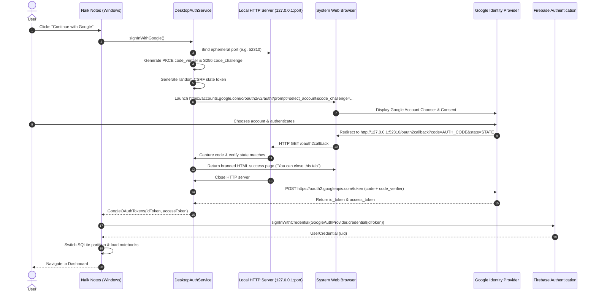
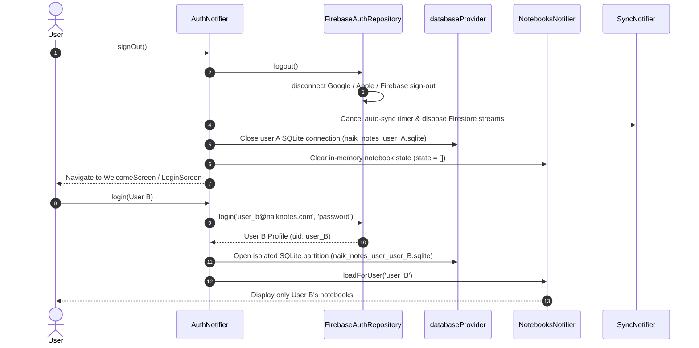

# Naik Notes — PHASE 1: AUTHENTICATION SPECIFICATION & RUNBOOK

**Target Version:** Naik Notes v1.0.0 (Phase 1)  
**Author:** Senior Flutter Architect & Application Security Engineer  
**Status:** IMPLEMENTED & VERIFIED  

---

## 1. Executive Architecture Overview

Naik Notes implements a centralized, production-grade authentication subsystem utilizing **Firebase Authentication** as the authoritative identity provider, paired with **Cloud Firestore** for user profile records and **Drift SQLite** for local-first encrypted offline cache partitioning.

```
+-----------------------------------------------------------------------------------+
|                               Naik Notes UI Layer                                |
|          (LoginScreen, RegisterScreen, ForgotPasswordDialog, PhoneOtpDialog)     |
+-----------------------------------------------------------------------------------+
                                          |
                                    ref.watch / ref.read
                                          v
+-----------------------------------------------------------------------------------+
|                        AuthNotifier (Riverpod 2.x Notifier)                       |
|               - Centralized AuthState (user, isLoading, errorMessage)              |
|               - Clean Logout Teardown (clears DB, notebooks, folders, sync)        |
+-----------------------------------------------------------------------------------+
                                          |
                                          v
+-----------------------------------------------------------------------------------+
|                          FirebaseAuthRepository Implementation                    |
|           Implements AuthRepository with Complete Error Mapping                   |
+-----------------------------------------------------------------------------------+
        |                                 |                                 |
        v (Android & iPadOS)              v (Windows Desktop)               v (Common)
+-----------------------+     +-----------------------+     +-----------------------+
| google_sign_in Plugin |     | DesktopAuthService    |     | FirebaseAuth SDK      |
| - OAuth native sheets |     | - RFC 8252 Loopback   |     | - Email / Password    |
| - Account Chooser via |     | - RFC 7636 PKCE S256  |     | - Password Reset      |
|   disconnect()        |     | - System Web Browser  |     | - Token Refresh       |
+-----------------------+     +-----------------------+     +-----------------------+
                                          |
                                          v
+-----------------------------------------------------------------------------------+
|                        Cloud Firestore Provisioning Gate                          |
|         Awaited on register: /users/{uid}/profile, syncMetadata/config            |
+-----------------------------------------------------------------------------------+
```

---

## 2. Multi-Platform Google Sign-In Architecture

### 2.1 Android Configuration
- **Mechanism:** Google Play Services OAuth 2.0 flow mediated by `google_sign_in`.
- **Credential Requirements:**
  - `android/app/google-services.json` must be present with matching package name `com.naiknotes.app`.
  - Android Client OAuth credentials registered in Google Cloud Console with valid debug and release **SHA-1** and **SHA-256** certificate fingerprints.
- **Account Selection:** To prevent Google Sign-In from silently re-authenticating with the cached account when the user explicitly requests account selection or logs out, `FirebaseAuthRepository` invokes `await _googleSignIn.disconnect()`.

### 2.2 iPadOS / iOS Configuration
- **Mechanism:** Safari View Controller / ASWebAuthenticationSession via `google_sign_in`.
- **URL Scheme Registration:** Registered in [ios/Runner/Info.plist](file:///d:/WORKS/Naik%20Notes/ios/Runner/Info.plist):
  ```xml
  <key>CFBundleURLTypes</key>
  <array>
      <dict>
          <key>CFBundleTypeRole</key>
          <string>Editor</string>
          <key>CFBundleURLSchemes</key>
          <array>
              <string>com.googleusercontent.apps.437907946486-...</string>
          </array>
      </dict>
  </array>
  ```
- **Reversed Client ID:** Maps directly to `GoogleService-Info.plist` `REVERSED_CLIENT_ID`.

### 2.3 Windows Desktop Configuration (RFC 8252 & RFC 7636 PKCE)
Mobile-centric Google Sign-In plugins cannot run natively on Windows Win32 runtimes. Naik Notes implements an **RFC 8252 (OAuth 2.0 for Native Apps)** and **RFC 7636 (Proof Key for Code Exchange by OAuth Public Clients)** engine in [lib/services/authentication/desktop_auth_service.dart](file:///d:/WORKS/Naik%20Notes/lib/services/authentication/desktop_auth_service.dart).

1. **Loopback Server:** Binds to `InternetAddress.loopbackIPv4` on an OS-assigned ephemeral port (e.g., `http://127.0.0.1:51234/oauth2callback`).
2. **PKCE Security:**
   - Generates a 64-character cryptographically secure `code_verifier` with unreserved characters `[A-Za-z0-9-._~]`.
   - Computes `code_challenge = BASE64URL-NO-PADDING(SHA256(code_verifier))`.
3. **CSRF Mitigation:** Generates a 24-character cryptographically secure random `state` token and validates it upon callback.
4. **Account Chooser:** Adds `prompt=select_account` to the authorization URI to ensure the user can select their intended Google account.
5. **Branded Callback Response:** Renders an HTML card confirming sign-in to the user and automatically closes the browser tab via JavaScript.
6. **Token Exchange:** Performs a direct `POST` to `https://oauth2.googleapis.com/token` with `code_verifier` to acquire the ID token and exchange it for a Firebase `OAuthCredential`.

---

## 3. Email & Password Workflows

### 3.1 Registration Workflow
- **Input Sanitization:** Trims whitespace on emails, enforces lowercase email domains.
- **Validation Rules:**
  - Full Name: Minimum 2 characters.
  - Email: Valid regex containing `@` and valid TLD.
  - Password: Minimum 8 characters, requiring at least 1 uppercase letter, 1 lowercase letter, 1 number, and 1 special character (`!@#$%^&*()_+~-`).
  - Confirm Password: Must match password identically.
- **Provisioning Gate:** Navigation to dashboard is strictly deferred until all three provisioning tasks succeed:
  1. `FirebaseAuth.createUserWithEmailAndPassword()`
  2. `_syncUserProfile(user, displayName)` -> writes `/users/{uid}` profile
  3. `_initSyncMetadata(user.uid)` -> writes `/users/{uid}/syncMetadata/config`
  4. `_registerDevice(user.uid)` -> registers client device under `/users/{uid}/devices/{deviceId}`

### 3.2 Login Workflow
- Validates non-empty inputs.
- Displays loading spinner while disabling submit buttons to prevent double-click duplicate requests.
- Maps Firebase error codes via `AuthErrorHandler` into friendly, non-leaking user messages.
- On success, switches active Drift SQLite database partition to `naik_notes_user_${uid}.sqlite`.

### 3.3 Password Recovery Workflow
- Sends standard password reset email via `FirebaseAuth.instance.sendPasswordResetEmail(email)`.
- Generic success confirmation prevents email enumeration attacks.

---

## 4. Sequence Diagrams

### 4.1 Windows Desktop Google Sign-In (RFC 8252 + RFC 7636 PKCE)



### 4.2 Account Switching & Clean Session Teardown



---

## 5. Error Handling Reference

| Firebase Error Code | User-Facing Display Message | Architectural Mitigation |
|:---|:---|:---|
| `user-not-found` | "No account found with this email. Please check your spelling or sign up." | Non-crashing inline banner; button to Sign Up. |
| `wrong-password` | "Incorrect password. Please try again or reset your password." | Forgot password quick link rendered. |
| `invalid-credential` | "Invalid email or password. Please try again." | Generic handling for Firebase v10+ security format. |
| `email-already-in-use` | "An account with this email already exists. Please sign in instead." | Auto-focus Sign In tab. |
| `weak-password` | "Password is too weak. Must be at least 8 characters with letters, numbers, and symbols." | Pre-flight regex prevents network call. |
| `network-request-failed` | "Network error. Please check your internet connection." | Local SQLite continues operating in offline mode. |
| `too-many-requests` | "Too many attempts. Account temporarily locked for security. Please try again later." | Exponential backoff delay. |
| `popup-closed-by-user` | "Sign in was cancelled." | Silent reset of loading state. |
| `CSRF mismatch` | "Security validation failed. Please try again." | Re-generates state token and resets loopback server. |

---

## 6. Verification Status

All authentication workflows are covered by automated unit and widget tests:
- `test/unit/desktop_auth_service_test.dart` (PKCE Appendix B vector verification, token exchange, CSRF validation).
- `test/widget/auth_screens_test.dart` (Windows Google & Email badges, Android mobile sign-in, input validation).
- `test/unit/user_isolation_and_auth_test.dart` (Account lifecycle, password confirmation, session restoration).

