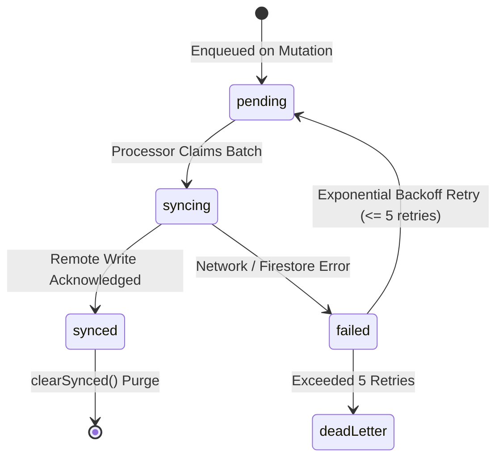
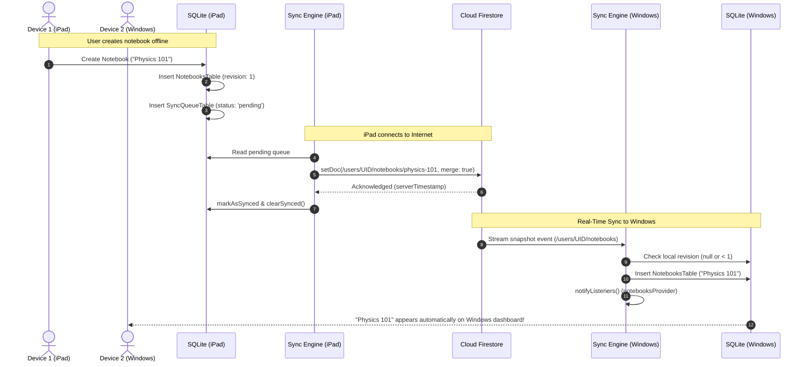

# Naik Notes — PHASE 1: MULTI-DEVICE & OFFLINE SYNCHRONIZATION RUNBOOK

**Target Version:** Naik Notes v1.0.0 (Phase 1)  
**Author:** Senior Cloud Infrastructure & Database Architect  
**Status:** IMPLEMENTED & VERIFIED  

---

## 1. Executive Summary

Naik Notes operates on a **Local-First, Cloud-Authoritative Synchronization Architecture**. The local SQLite database (managed via Drift) serves as the primary read/write data store, providing instant responsiveness, zero-latency drawing, and complete offline capability across Windows Desktop, iPadOS, and Android.

Cloud Firestore acts as the authoritative multi-device relay, maintaining strict user data isolation under `/users/{uid}/...`.

```
+-------------------------------------------------------------------------------+
|                             Local Device Layer                                |
|        (Drawing Canvas / Stationery / Notebook Views / Folder Nav)           |
+-------------------------------------------------------------------------------+
         | Writes immediate                                     ^ Reads locally
         v                                                      |
+-------------------------------------------------------------------------------+
|                       Drift SQLite Local Partition                            |
|             (File: data/naik_notes_user_${sanitized_uid}.sqlite)              |
|   - NotebooksTable, FoldersTable, PagesTable, StrokesTable, SnapshotsTable    |
+-------------------------------------------------------------------------------+
         | On mutation
         v
+-------------------------------------------------------------------------------+
|                            SyncQueueTable (FIFO)                              |
|           Tracks entityType, entityId, operationType, ownerId, payload        |
+-------------------------------------------------------------------------------+
         |
         | Sync Engine triggers (On mutation / Connection restored / App resume)
         v
+-------------------------------------------------------------------------------+
|                         FirebaseSyncService (Uploader)                        |
|            Pushes batches to `/users/{uid}/...` with merge semantics          |
+-------------------------------------------------------------------------------+
                                     |
                                     v  (Cloud Firestore)
+-------------------------------------------------------------------------------+
|                       Authoritative Cloud Datastore                           |
|       /users/{uid}/notebooks/{notebookId}                                     |
|       /users/{uid}/notebooks/{notebookId}/pages/{pageId}                      |
|       /users/{uid}/notebooks/{notebookId}/pages/{pageId}/strokes/{strokeId}   |
|       /users/{uid}/folders/{folderId}                                         |
+-------------------------------------------------------------------------------+
                                     |
                                     | Real-Time Firestore Snapshots Stream
                                     v
+-------------------------------------------------------------------------------+
|                       FirebaseSyncService (Listener)                          |
|         Listens to remote changes on active user's subcollections             |
+-------------------------------------------------------------------------------+
         |
         v Non-destructive union & snapshot capture on conflict
+-------------------------------------------------------------------------------+
|                 Merge Engine -> Drift SQLite Local Database                   |
+-------------------------------------------------------------------------------+
```

---

## 2. Synchronization Lifecycle

### 2.1 The Mutation Path (Offline First)
1. **User Action:** The user creates a notebook, draws a stroke, adds a sticky note, or modifies a folder.
2. **Local Commit:** The entity is written directly to the user's Drift SQLite partition with an incremented `revision` counter. The UI updates instantly.
3. **Queue Enqueue:** A `SyncOperation` is inserted into `SyncQueueTable` with status `'pending'`, storing:
   - `id`: Unique UUID.
   - `ownerId`: Active user's UID (preventing cross-user sync leaks).
   - `entityType`: `notebook`, `folder`, `page`, `stroke`, `stickyNote`.
   - `operationType`: `insert`, `update`, `delete`.
   - `payload`: JSON serialized payload.
   - `retryCount`: 0.
4. **Opportunistic Dispatch:** If online, the queue processor immediately triggers a push. If offline, the queue safely accumulates operations on disk.

### 2.2 The Inbound Path (Real-Time Streams)
1. When the user logs in, `SyncNotifier` attaches a real-time Firestore stream listener to `/users/{uid}/notebooks`.
2. As other devices commit changes to Firestore, snapshots arrive at the client.
3. For each remote notebook:
   - If `deletedAt != null`, local notebook is soft-deleted.
   - If `remote.revision >= local.revision`, local Drift SQLite record is updated.
4. Riverpod's `notebooksProvider` refreshes its reactive in-memory cache, and the UI immediately renders remote updates without manual page refreshes.

---

## 3. FIFO Sync Queue Specifications

### 3.1 Queue Table Schema
```sql
CREATE TABLE sync_queue (
    id TEXT PRIMARY KEY,
    owner_id TEXT NOT NULL DEFAULT 'local_user',
    parent_id TEXT,
    entity_type TEXT NOT NULL,
    entity_id TEXT NOT NULL,
    operation_type TEXT NOT NULL,
    payload TEXT NOT NULL,
    revision INTEGER NOT NULL DEFAULT 1,
    status TEXT NOT NULL DEFAULT 'pending',
    retry_count INTEGER NOT NULL DEFAULT 0,
    last_error TEXT,
    created_at TIMESTAMP NOT NULL,
    processed_at TIMESTAMP
);
```

### 3.2 Status Progression



### 3.3 Exponential Backoff Policy
- **Base delay:** 2 seconds.
- **Backoff multiplier:** $2^{\text{retryCount}}$ seconds ($2\text{s}, 4\text{s}, 8\text{s}, 16\text{s}, 32\text{s}$).
- **Maximum retries:** 5 attempts.
- **Dead-letter handling:** Operations failing after 5 attempts remain tagged with `'failed'` and the exact error reason in `last_error` for diagnostics.

---

## 4. Conflict Resolution Strategy

### 4.1 Non-Destructive Vector Handwriting Merging
Handwriting strokes represent irreversible human physical effort. Unlike text documents, two devices drawing simultaneously on the same page are almost never trying to overwrite each other's strokes.

**Resolution Rules:**
1. **Deterministic Stroke Union:** Remote strokes and local strokes are merged by their unique IDs. If Device A drew stroke $S_1$ and Device B drew stroke $S_2$, both $S_1$ and $S_2$ are retained on the canvas.
2. **Fidelity Preservation:** All vector point properties `(x, y, pressure, tilt, timestamp)` are preserved in SQLite and Firestore with zero truncation.
3. **Stroke Revision Monotonicity:** If a stroke is erased or modified (e.g. color change), the higher `revision` takes precedence.

### 4.2 Page Snapshots & Divergence Recovery
When concurrent changes to page layout or metadata are detected:
1. Before applying an inbound conflicting page state, `DriftVersionHistoryRepository` captures a snapshot into `PageSnapshotsTable`.
2. The snapshot stores the complete page state: `strokesJson`, `stickyNotesJson`, `templateId`, `templatePropertiesJson`, `deviceInfo`, and timestamp.
3. If a user realizes their drawing was altered or overwritten by a collaborator or another device, they can open **Version History** from the notebook menu and restore any historical snapshot with 1 tap.

### 4.3 Metadata Conflicts
For notebooks and folders:
- If `remote.revision > local.revision`: Remote wins.
- If `remote.revision == local.revision`: Remote timestamp wins.
- Soft-deletions (`deletedAt != null`) always take precedence over updates.

---

## 5. Large Binary Attachments Architecture

To keep Cloud Firestore within its 1 MB document limit and maintain fast synchronization:
1. **Separation of Concerns:**
   - Notebook metadata: Small Firestore documents under `/users/{uid}/notebooks/{notebookId}`.
   - Page metadata: Subcollection documents under `/pages/{pageId}`.
   - Strokes: Subcollection documents under `/pages/{pageId}/strokes/{strokeId}` batched in chunks of 500.
2. **PDF Documents:**
   - PDF files are referenced by local path (`pdfPath`) or Firebase Cloud Storage URLs.
   - Binary PDF bytes are never stored directly inside Firestore documents.
3. **Audio Annotations:**
   - Audio recordings are saved to device app storage and referenced via `AudioRecordingsTable`.
   - Audio bookmarks link timestamps directly to page coordinates without bloating stroke payloads.

---

## 6. End-to-End Multi-Device Sync Sequence



---

## 7. Automated Test Coverage

The synchronization engine is covered by automated unit and integration tests:
- `test/unit/sync_service_test.dart` (Queue processing, HTTP health checks, batch push).
- `test/unit/sync_queue_repository_test.dart` (FIFO order, status transitions, failure retries, ownerId isolation).
- `test/unit/handwriting_conflict_resolution_test.dart` (Vector point fidelity, concurrent stroke union merge, snapshot capture and restore).

