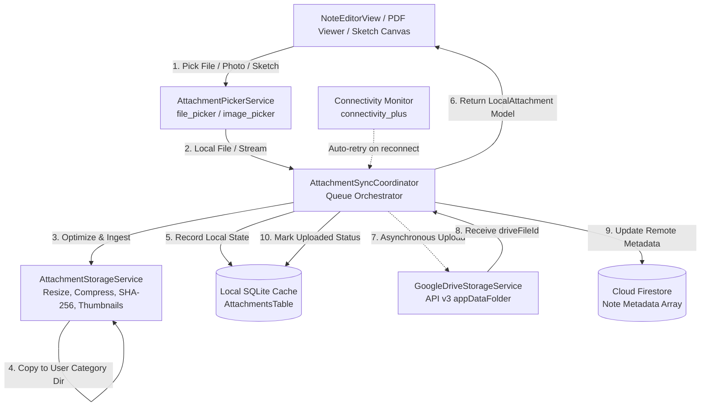
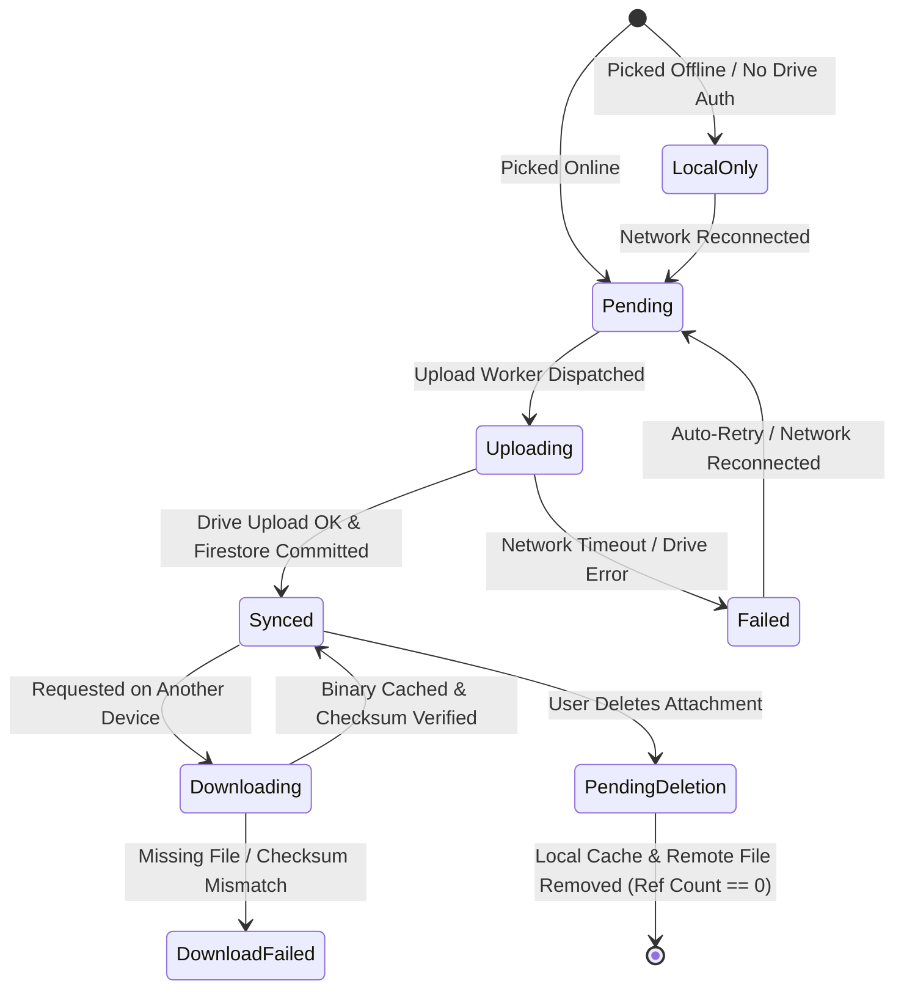
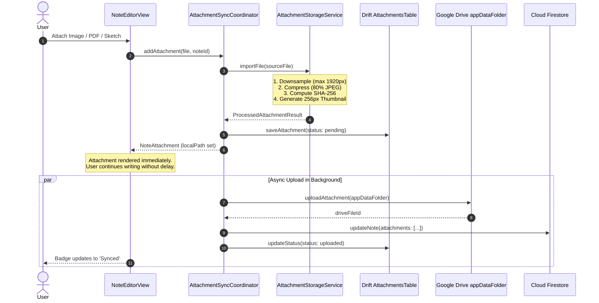
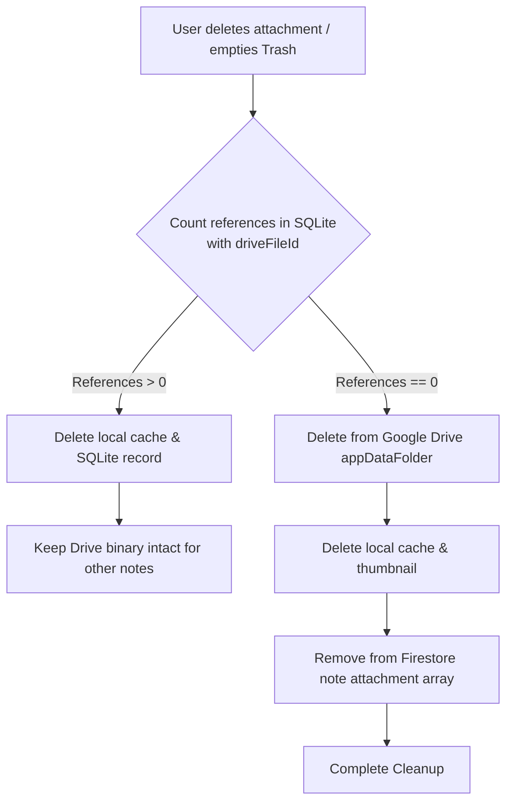

# Naik Notes — Phase 4 Attachment Architecture
**Cross-Platform Storage, Offline Queue, Google Drive appDataFolder & iPad Sketching**
**Date:** November 22, 2026  

---

## 1. System Overview

Naik Notes adopts a **Hybrid Offline-First Architecture** designed to deliver instant responsiveness while safeguarding user data privacy and bandwidth across Windows, Android, and iPadOS:

1. **Rich-Text Notes & Attachment References**: Persisted in local Drift SQLite and synchronized with Cloud Firestore (`notebooks/{noteId}`).
2. **Raw Binaries (Images, PDFs, Sketches, Documents)**: Stored in the authenticated user's private Google Drive `appDataFolder` (hidden from regular Drive file browsing, protecting against accidental deletion).
3. **Local Filesystem Cache**: Partitioned under `getApplicationDocumentsDirectory()/users/{sanitized_uid}/attachments/` for offline availability and zero-latency display.
4. **Resilient Synchronization Queue**: Managed via Drift SQLite (`AttachmentsTable`) and auto-resumed via network connectivity triggers (`connectivity_plus`).

---

## 2. Component Architecture Diagram



---

## 3. Local Filesystem Directory Structure

Attachment files are sandboxed and partitioned per user ID:

```text
getApplicationDocumentsDirectory()/
└── users/
    └── {sanitized_uid}/
        └── attachments/
            ├── images/
            │   └── {uuid}.jpg / {uuid}.png
            ├── documents/
            │   └── {uuid}.docx / {uuid}.txt
            ├── pdfs/
            │   └── {uuid}.pdf
            ├── sketches/
            │   └── {uuid}.png
            ├── thumbnails/
            │   └── {uuid}_thumb.jpg
            └── temporary/
                └── (staging buffers)
```

### Path Sanitization
User IDs (such as email addresses or alphanumeric IDs) are sanitized via:
```dart
static String sanitizeUid(String uid) {
  final sanitized = uid.replaceAll(RegExp(r'[^a-zA-Z0-9_-]'), '_');
  final cleaned = sanitized.replaceAll(RegExp(r'^_+|_+$'), '');
  return cleaned.isEmpty ? 'local_user' : cleaned;
}
```
This guarantees cross-platform filesystem compatibility without invalid directory characters across Windows, Android, and iOS/iPadOS.

---

## 4. Attachment Lifecycle & State Machine



### State Definitions:
- `local_only`: File imported locally; Google Drive account not linked.
- `pending`: Queued for background upload.
- `uploading`: Actively transferring chunks to Google Drive API v3.
- `uploaded` (Synced): Remote file exists in `appDataFolder`; metadata committed to Cloud Firestore.
- `downloading`: Fetching binary on-demand for a note created on another device.
- `failed`: Upload encountered network or authorization error; queued for auto-retry.
- `pending_deletion`: Marked for safe cleanup.

---

## 5. Non-Blocking Synchronous UI Pipeline

To ensure typing, scrolling, and editing notes is never blocked while uploading large files:



---

## 6. iPad Apple Pencil & Sketching Subsystem

The `SketchCanvasDialog` captures touch and stylus events:
1. **Pressure Sensitivity**: `PointerMoveEvent.pressure` modulates stroke width smoothly according to tool type.
2. **Bezier Smoothing**: Raw input coordinates are smoothed using quadratic / cubic bezier interpolation, eliminating jitter.
3. **Tools**:
   - **Pen**: Dynamic pressure, crisp ink, 100% opacity.
   - **Pencil**: Textured graphite rendering with lighter opacity.
   - **Highlighter**: Wide translucent marker with `BlendMode.multiply`.
   - **Eraser**: Segment distance hit-testing deletes touched strokes.
4. **Direct PNG Export**:
   ```dart
   final recorder = ui.PictureRecorder();
   final canvas = Canvas(recorder);
   // ... paint strokes ...
   final picture = recorder.endRecording();
   final img = await picture.toImage(width, height);
   final byteData = await img.toByteData(format: ui.ImageByteFormat.png);
   await coordinator.addAttachmentFromBytes(
     bytes: byteData.buffer.asUint8List(),
     isSketch: true,
   );
   ```
   Exports directly to memory bytes and saves to `users/{uid}/attachments/sketches/`, completely bypassing temporary picker files.

---

## 7. Storage Hygiene & Safe Deletion Model

To prevent accidental data loss when notes are duplicated or reference identical attachments:



### Trash Retention Rule
- Moving a note to Trash sets `isDeleted: true` on the note document.
- Local attachment binaries, thumbnails, and remote Google Drive files are **strictly preserved** while in Trash.
- When the user restores the note, all attachments remain instantly available.
- When the user permanently empties the Trash, `onNotePermanentlyDeleted()` triggers the cleanup pipeline.

