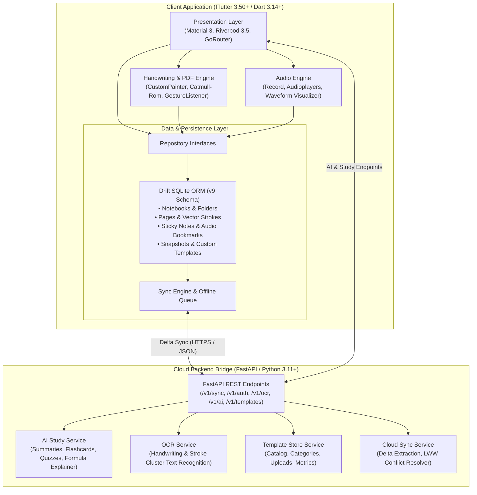

# Naik Notes

[](https://flutter.dev)
[](https://dart.dev)
[](https://fastapi.tiangolo.com)
[](https://python.org)
[](https://drift.simonbinder.eu)
[](https://opensource.org/licenses/MIT)
[](#automated-testing--verification)

**Naik Notes** is an original, production-grade, 100% free cross-platform digital notebook and PDF annotation suite engineered for **iPadOS**, **Android**, and **Windows 10/11**.

Inspired by fine paper stationery, Naik Notes combines realistic textured covers and paper templates with an ultra-responsive vector handwriting engine, low-latency stylus hardware integration (Apple Pencil, Samsung S-Pen, Microsoft Surface Pen), non-destructive PDF annotation, background cloud synchronization, synchronized lecture audio, and an AI study assistant.

---

## 🌟 Comprehensive Feature Matrix

### 1. Realistic Stationery & Aesthetic Design
- **Hand-Crafted Cover Designs**: Vintage Leather, Dark Academia, Terracotta Clay, Sage Forest, Blush Floral, and Midnight Slate with tactile spine bindings and textured foil finishes.
- **Custom Folder Taxonomy**: Nested organizational hierarchy with custom folder colors, icons, and instant notebook organization.
- **Adaptive Dashboard**: Responsive library view switching effortlessly between high-density grid covers and detailed list metadata views with search filtering.

### 2. Built-in 19 Paper Template Suite
- **Academic & Notes**: Blank Canvas, Narrow Ruled (6.35mm), College Ruled (7.1mm with margin guide), Wide Ruled (8.7mm), Cornell Notes (with cue column and summary section), Meeting Notes.
- **Technical & Scientific**: 5mm Square Quad Grid, Precision 1mm/5mm Graph Paper, Engineering Computation Paper (with header project block and pale tint), 60° Isometric Triangular Grid.
- **Planners & Productivity**: Daily Timetable Planner (06:00-21:00 with priority box), Weekly Overview Planner, Monthly 5x7 Calendar Grid, Study Revision Planner, Checklist & Task Matrix, Double-Border Journal Page.
- **Specialty Formats**: 5-Line Musical Manuscript Staves, Custom User Dimensions.
- **Deep Customization**: Real-time paper tinting (Ivory Cream `#FDFBF7`, Pure White `#FFFFFF`, Vintage Sepia `#F5EFEB`, Dark Slate `#1E2022`, Sage Mint `#F0F5F2`, Blush Rose `#FAF0F2`), line spacing adjustments, margin toggles, and ISO sizes (A4, A5, US Letter).

### 3. Advanced Vector Handwriting Engine
- **Sub-Pixel Vector Storage**: Resolution-independent stroke coordinates with pressure dynamics, tilt angles, and timestamp tracking.
- **Natural Inking Tools**: Ballpoint Pen, Fountain Pen (with velocity-sensitive nib spreading), Technical Pencil (with graphite texture shading), Chisel Highlighter (semi-transparent blending), and Precision Stroke Eraser.
- **Smoothing Algorithms**: Catmull-Rom spline fitting and Bezier curve smoothing for natural, anti-aliased freehand strokes.
- **Lasso Tool & Manipulation**: Vector contour selection supporting drag translation, uniform scaling, rotation, and stroke deletion.
- **Undo / Redo History**: High-capacity non-destructive command history stack with zero memory leaks.

### 4. PDF Workspace & Annotation Engine
- **Multi-Page Native PDF Rendering**: High-performance multi-page view with pinch-to-zoom (0.4x - 4.0x) and fast thumbnail navigation sidebar.
- **Non-Destructive Inking Layer**: Vector ink and highlighting stored independently from underlying PDF document streams.
- **Rich Sticky Notes**: Movable, resizable markdown-compatible sticky notes with color coding.
- **High-Fidelity Flattened Export**: Render pages with underlying PDF documents, vector annotations, and sticky notes combined into standard vector-rasterized PDF files ready for printing or sharing.

### 5. Native Hardware & Stylus Integration
- **Digitizer Precision**: Native hardware events for Apple Pencil (iPadOS), Samsung S-Pen (Android), and Microsoft Surface Pen (Windows DirectInk).
- **Stylus Button Switching**: Automatic hardware barrel button mapping to toggle instant stroke eraser mode.
- **Intelligent Palm Rejection**: Differentiates human palm touch from stylus digitizer nibs to prevent stray marks.
- **Keyboard Shortcuts**: 15+ desktop and tablet keyboard shortcuts (`Ctrl/Cmd+Z`, `Ctrl/Cmd+Shift+Z`, `Ctrl/Cmd+S`, `Ctrl/Cmd+F`, `Ctrl/Cmd+P`, tool shortcuts `1-5`).

### 6. On-Device & Cloud Handwriting Recognition (OCR) & Search
- **Optical Character Recognition**: Extracts handwriting text from vector stroke clusters and raster image layers.
- **Searchable Handwritten Index**: Automated background SQLite full-text search indexing (`PageSearchRepository`).
- **Global & In-Document Search**: Instant search queries highlighting matching words with glowing vector bounding boxes on the live canvas.

### 7. Synchronized Lecture Audio & Waveform Scrubber
- **High-Fidelity Recording**: Compressed AAC/M4A audio recording synced directly to page content.
- **Interactive Waveform Visualizer**: Live decibel level meter during recording and interactive scrubber bar during playback.
- **Stroke-to-Audio Synchronization**: Every stroke records exact relative audio millisecond offsets, allowing users to tap any stroke to jump audio playback to the exact moment it was written.
- **Audio Bookmarks**: Named timeline pins for rapid topic navigation during lecture review.

### 8. AI Study Assistant & Smart Review
- **FastAPI Microservice Bridge**: Powered by Gemini API / OpenAI compatible endpoints with zero client secret exposure.
- **Structured Executive Summaries**: Distills dense handwritten notes into key takeaways, core concepts, and review recommendations.
- **Instant Study Flashcards**: Automatically extracts definitions, formulas, and concepts into interactive flashcards with revealable answers.
- **Practice Quizzes**: Generates multiple-choice and short-answer diagnostic quizzes with answer rationales.
- **Formula Explainer & Pedagogical Chat**: Breaks down complex mathematical formulas and answers questions grounded directly in student lecture notes.

### 9. Page Version History & Differential Snapshots
- **Immutable Snapshots**: Captures point-in-time snapshots of vector strokes, sticky notes, and paper properties.
- **Visual Revision Timeline**: Version badges (`v1`, `v2`, ...), timestamps, stroke and note count differential metrics.
- **Atomic Rollback**: Single-tap restoration reverts active pages to any prior snapshot without risking data corruption.

### 10. Community Template Store & Custom Marketplace
- **Curated Catalog**: Built-in template repository categorized by Math & Science, Engineering, Planning, Music, Language, and Art & Design.
- **Custom Template Designer**: Save custom rulings, grid spacing, margins, and paper colors as reusable templates.
- **JSON Import & Export**: One-tap JSON template exchange enables sharing layouts with classmates or colleagues.
- **Community Publishing**: Publish templates to the FastAPI catalog with download counters and rating feedback.

### 11. Offline-First Cloud Synchronization
- **Drift SQLite Architecture**: All operations commit instantly to local SQLite before queueing for cloud synchronization.
- **FastAPI Delta Sync Bridge**: RESTful push/pull synchronization transferring only modified deltas.
- **Conflict Resolution**: Deterministic Last-Write-Wins (LWW) conflict resolution with client-side synchronization diagnostics.

---

## 🏛️ System Architecture



---

## 📁 Repository Structure

```
naik_notes/
├── android/                   # Native Android host & permissions
├── assets/                    # Stationary assets, covers, icons
├── backend/                   # FastAPI Python backend service
│   ├── app/
│   │   ├── api/               # API route definitions (ai, auth, ocr, sync, templates)
│   │   ├── core/              # Config, CORS, security settings
│   │   ├── schemas/           # Pydantic data validation schemas
│   │   └── services/          # Business logic (ai, ocr, sync, templates)
│   └── tests/                 # Backend Pytest test suite (20 tests)
├── docs/                      # Progress documentation & specifications
│   ├── PROGRESS.md            # Detailed milestone tracking across all 12 phases
│   └── ...
├── lib/                       # Flutter frontend codebase
│   ├── core/                  # Theme, constants, routing, configuration
│   ├── data/                  # Drift SQLite database, models, and repositories
│   │   ├── local/             # Drift database definitions & migration logic (v1-v9)
│   │   ├── models/            # Entity models (notebooks, strokes, audio, templates)
│   │   └── repositories/      # Drift repository implementations
│   ├── features/              # Feature modules
│   │   ├── ai_assistant/      # AI study assistant sheet, flashcards, quizzes
│   │   ├── audio/             # Waveform scrubber, audio notes, bookmarks
│   │   ├── auth/              # Guest & email auth session
│   │   ├── canvas/            # Vector handwriting canvas, smoothing, tools
│   │   ├── dashboard/         # Notebook library, folder chips, cover grid
│   │   ├── notebooks/         # Notebook view, page navigation, export
│   │   ├── pdf/               # PDF viewer, thumbnails, sticky notes
│   │   ├── search/            # Handwriting search overlay & highlights
│   │   ├── sync/              # Sync status indicators & diagnostics dialog
│   │   ├── template_store/    # Community template store & custom designer
│   │   ├── templates/         # 19 paper vector painters & customizer sheet
│   │   └── version_history/   # Page snapshot timeline & atomic restore
│   ├── services/              # External service integrations (audio, AI, sync, OCR)
│   └── main.dart              # Application entry point
├── test/                      # Frontend Flutter test suite (159 tests)
│   ├── unit/                  # Repositories, models, and service tests
│   └── widget/                # UI component, canvas, and flow widget tests
├── web/                       # Web platform manifest & entrypoint
└── windows/                   # Native Windows 10/11 runner & resources
```

---

## 🚀 Getting Started

### Prerequisites

- **Flutter SDK**: 3.50.0 or later ([Flutter Install Guide](https://docs.flutter.dev/get-started/install))
- **Dart SDK**: 3.14.0 or later
- **Python**: 3.11 or later ([Python Downloads](https://www.python.org/downloads/))
- **Platform Toolchains** (as needed for your target platform):
  - **Windows**: Visual Studio 2022 with "Desktop development with C++"
  - **Android**: Android Studio & Android SDK 34+
  - **Web**: Google Chrome / Microsoft Edge

---

### Running the Flutter Client

```powershell
# 1. Fetch Flutter dependencies
flutter pub get

# 2. Run static analysis (must report 0 issues)
flutter analyze

# 3. Execute all 159 frontend tests
flutter test

# 4. Launch on your desired device / platform:
flutter run -d chrome      # Web Browser
flutter run -d windows     # Windows 10/11 Desktop
flutter run -d <device-id> # Android / iPadOS (via device selector)
```

---

### Running the FastAPI Backend

```powershell
# 1. Navigate to backend directory
cd backend

# 2. Create and activate a Python virtual environment
python -m venv venv
.\venv\Scripts\Activate.ps1   # On Windows (or source venv/bin/activate on macOS/Linux)

# 3. Install backend dependencies
pip install -r requirements.txt

# 4. Execute the 20 backend Pytest tests
pytest backend/tests -v

# 5. Start the development server
uvicorn app.main:app --reload --port 8000
```

The interactive API documentation is available at `http://localhost:8000/docs`.

---

## 🧪 Automated Testing & Verification

Naik Notes adheres to rigorous testing standards. Every phase has been verified with authentic test execution and zero static analysis warnings:

```powershell
# Full client test suite (159 passing unit & widget tests)
flutter test

# Backend microservices test suite (20 passing Pytest tests)
$env:PYTHONPATH="backend"; pytest backend/tests -v

# Static analysis validation
flutter analyze
```

### Production Build Verification

```powershell
# Web Production Release
flutter build web --release

# Windows Desktop Release (on Windows build hosts)
flutter build windows --release

# Android Production APK (on Android build hosts)
flutter build apk --release
```

---

## 📄 License & Pricing

Naik Notes is released under the **MIT License**. It is **100% free and open** — there are no paywalled features, no artificial limits on notebook creation, and no mandatory subscriptions.
